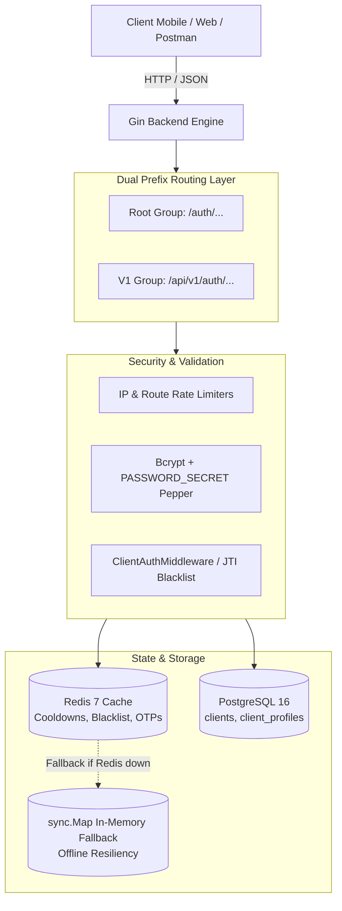
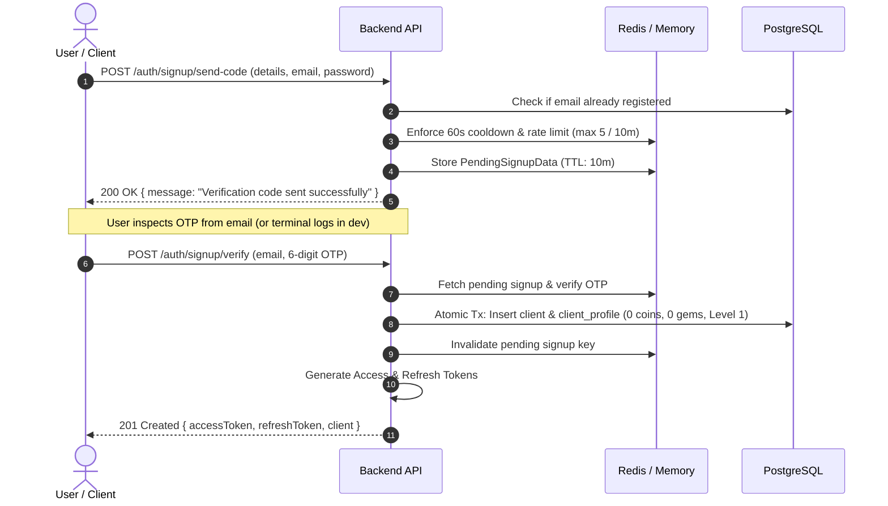

# Authentication & Client Session Specification

This document provides the authoritative specification for authentication, user registration, token lifecycle, password management, and security mechanisms in the **Gamified Quiz App Backend**.

---

## 1. Architectural Overview



### Key Architectural Tenets:
1. **Dual Route Registration**: Every auth route is registered twice—at the root (`/auth/...`) and under `/api/v1` (`/api/v1/auth/...`).
2. **Password Security**: Passwords are never stored in plaintext and never hashed with standard bcrypt alone. Passwords are salted and peppered: `bcrypt(password + PASSWORD_SECRET)`.
3. **Stateless JWTs with Secure Cookies**: Login and signup issue both a short-to-medium lived Access Token and a long-lived Refresh Token. Tokens are delivered both in the JSON response payload and via `HttpOnly`, `SameSite=Lax` secure cookies (`clientAccessToken`, `clientRefreshToken`).
4. **JTI Revocation & Redis Blacklisting**: On logout, the Access Token's unique `jti` (JWT ID) is blacklisted in Redis for the remaining duration of its TTL, preventing token reuse even before natural expiration.
5. **Zero-Downtime Redis Fallback**: If Redis is offline or unconfigured, rate limiting, signup cooldowns, and OTP stashes degrade seamlessly to thread-safe in-memory maps (`sync.RWMutex`), ensuring unit tests and offline environments run smoothly.

---

## 2. Token Lifecycle & Specifications

| Token Type | Claim Payload | Default Lifetime | Storage / Transmission |
| :--- | :--- | :--- | :--- |
| **Access Token** | `client_id`, `email`, `exp`, `jti` | 30 days (configurable via `JWT_ACCESS_TOKEN_EXPIRY`) | Response JSON + `clientAccessToken` cookie + `Authorization: Bearer <token>` header |
| **Refresh Token** | `client_id`, `email`, `exp` | 90 days (configurable via `JWT_REFRESH_TOKEN_EXPIRY`) | Response JSON + `clientRefreshToken` cookie + DB `clients.refresh_token` |

### WebSocket Token Authentication
WebSockets (`/ws/game` and `/api/v1/ws/game`) cannot send custom HTTP headers during the browser upgrade handshake. Clients authenticate by supplying the JWT Access Token in the query parameter:
```
ws://localhost:8080/ws/game?token=<access_token>
```

---

## 3. Endpoints & API Reference

All requests and responses use standard JSON with the response envelope:
```json
{
  "success": true,
  "message": "Operation description",
  "data": { ... },
  "errors": null,
  "timestamp": "2026-10-18T11:00:00Z"
}
```

### 3.1 Authentication (`/auth`)

#### 1. Login
- **Endpoint**: `POST /auth/login` (or `/api/v1/auth/login`)
- **Headers**: `Content-Type: application/json`
- **Request Body**:
  ```json
  {
    "email": "player@example.com",
    "password": "secretpassword123"
  }
  ```
- **Success Response (`200 OK`)**:
  ```json
  {
    "success": true,
    "message": "Client logged in successfully",
    "data": {
      "accessToken": "eyJhbGciOi...",
      "refreshToken": "eyJhbGciOi...",
      "tokenType": "Bearer",
      "expiresIn": 2592000,
      "client": {
        "id": 1,
        "username": "demo_player",
        "email": "player@example.com",
        "phone": "+1234567890",
        "status": "active"
      },
      "message": "Authentication successful."
    }
  }
  ```

#### 2. Refresh Token
- **Endpoint**: `POST /auth/refresh` (or `/api/v1/auth/refresh`)
- **Headers**: `Content-Type: application/json`
- **Request**: Sent via `clientRefreshToken` cookie automatically, or explicitly in the request body:
  ```json
  {
    "refreshToken": "eyJhbGciOi..."
  }
  ```
- **Success Response (`200 OK`)**:
  ```json
  {
    "success": true,
    "message": "Token refreshed successfully",
    "data": {
      "accessToken": "eyJhbGciOi...",
      "message": "Access token refreshed and updated in cookie."
    }
  }
  ```

#### 3. Logout
- **Endpoint**: `POST /auth/logout` (or `/api/v1/auth/logout`)
- **Authentication**: Required (`Bearer <access_token>` or `clientAccessToken` cookie)
- **Action**: Clears refresh token in PostgreSQL, blacklists the current JWT `jti` in Redis, and clears auth cookies.
- **Success Response (`200 OK`)**:
  ```json
  {
    "success": true,
    "message": "Client logged out successfully",
    "data": {
      "message": "Logged out successfully and cookies cleared."
    }
  }
  ```

---

### 3.2 Registration & Signup Flow (`/auth/signup`)

Registration is a two-step verified flow to prevent spam and verify email ownership.



#### Step 1: Send Verification Code
- **Endpoint**: `POST /auth/signup/send-code`
- **Request Body**:
  ```json
  {
    "username": "new_player",
    "email": "new_player@example.com",
    "password": "securepassword123",
    "phone": "+1987654321"
  }
  ```
- **Rate Limit & Cooldown**:
  - Max 5 verification requests per email per 10-minute window.
  - 60-second cooldown between resend requests.

#### Resend Code
- **Endpoint**: `POST /auth/signup/resend-code`
- **Request Body**:
  ```json
  {
    "email": "new_player@example.com"
  }
  ```

#### Step 2: Verify & Create Account
- **Endpoint**: `POST /auth/signup/verify`
- **Request Body**:
  ```json
  {
    "email": "new_player@example.com",
    "otp": "123456"
  }
  ```
- **Success Response (`201 Created`)**:
  Returns the created `client` profile and tokens, immediately authenticating the user.

---

### 3.3 Session Inspection (`/session`, `/verify-session`)

Authenticated routes requiring `Bearer <token>`:

- `GET /session` (or `/api/v1/session`): Returns current client profile details.
- `GET /verify-session` (or `/api/v1/verify-session`): Lightweight health-check returning `{"active": true, "status": "active"}`.

---

### 3.4 Password Recovery & Change

#### Change Password (Authenticated)
1. **Request Code**: `POST /change-password-request` with `{"oldPassword": "...", "newPassword": "..."}`. Generates a 2-minute verification OTP.
2. **Verify Change**: `POST /change-password-verify` with `{"otp": "123456"}`. Updates password hash with new pepper.

#### Forgot Password (Unauthenticated)
1. **Request Reset**: `POST /auth/forgot-password` with `{"email": "player@example.com"}`. Rate-limited to 5 requests per 10 minutes.
2. **Verify Token**: `POST /auth/forgot-password/verify` with `{"email": "...", "token": "..."}`.
3. **Reset Password**: `POST /auth/forgot-password/reset` with `{"email": "...", "token": "...", "newPassword": "..."}`.
