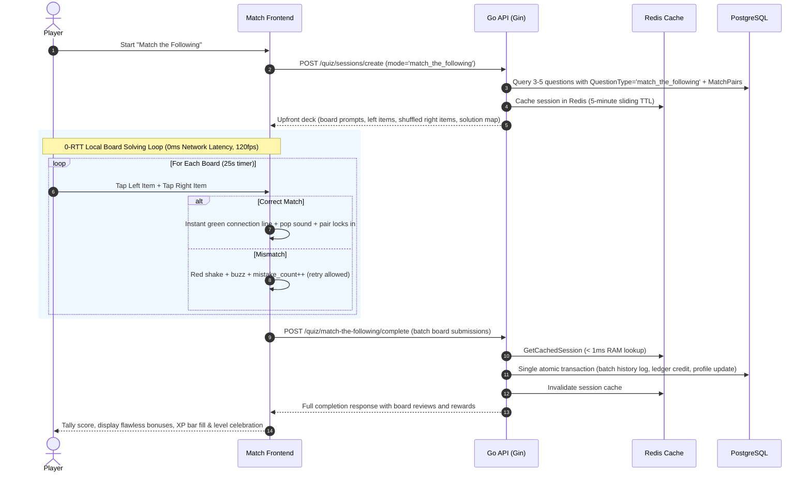

# Implementation Plan: "Match the Following" Multi-Board Game Engine

## Goal Description
Implement the complete backend engine for **"Match the Following"** (`game_mode: "match_the_following"`), a multi-board matching puzzle game where players connect pairs (e.g. Terms & Definitions, Accounts & Nature, Financial Statements & Items) across two columns under time pressure.

Key architectural pillars:
1. **Multi-Board Game Session**: Each session consists of 3–5 boards (default 3 or 5), where each board contains exactly 4 pairs (Left Column vs. Right Column).
2. **Normalized Relational Data Model**: A new `match_pairs` table linked by foreign key to `questions` (`question_id`), storing `pair_order`, `left_text`, and `right_text`.
3. **Zero-Latency In-Game Play (0-RTT)**: All boards, prompts, left items, shuffled right items, and matching keys are loaded upfront in `POST /quiz/sessions/create`. Players solve boards with zero network roundtrips.
4. **Time Pressure & Mistake Handling**: 
   - 20–30s per-board countdown (default 25s, configurable).
   - If an incorrect match is made, the UI flashes red and allows retrying until the board is solved or the timer expires. Each mistake incurs a small point deduction.
   - If time expires, unmatched pairs on that board count as missed (0 pts) and the game auto-advances to the next board.
5. **Balanced Gamified Scoring Engine**:
   - **Base Points**: 10 pts per correctly matched pair (40 pts max base per board).
   - **Flawless Clear Bonus**: +10 pts per board if cleared with 0 mistakes.
   - **Speed Bonus**: +1 pt per second remaining on the board timer upon board clearance.
   - **Mistake Penalty**: -2 pts per wrong attempt (clamped so board score cannot drop below 0).
   - **Economy Rewards**: Base XP & Coins + Accuracy XP/Coins + Perfect Run Bonus + Gems, settled atomically to player wallet and profile.
6. **Dedicated Batch Completion API**: `POST /quiz/match-the-following/complete` (mirrored under `/api/v1/quiz/match-the-following/complete`).
7. **Redis Session Caching with Strict TTL**: Active sessions are cached in Redis (`quiz:session:cache:<id>`) with a 5-minute sliding inactivity TTL (`SessionInactivityTTL`) and write-through/cache-aside persistence.

---

## User Review Required
> [!IMPORTANT]
> - **New Table Migration (`match_pairs`)**: Per AGENTS.md, a new model `MatchPair` will be registered in `internal/models/game_model.go`, `AllModels()` in `internal/database/migration.go`, and the `tables` slice in `db.Status()` to ensure proper migration and status reporting.
> - **Shuffled Right Column**: To prevent trivial across-the-row answers, right-column items are shuffled before client delivery while preserving deterministic pair identifiers for 0ms client-side validation.
> - **Dedicated Completion Endpoint**: Route `POST /quiz/match-the-following/complete` is mirrored under `/api/v1/quiz/match-the-following/complete` via the shared route registration closure.

---

## Proposed Changes & Architecture

```mermaid
graph TD
    Client[Frontend Client] -->|1. POST /quiz/sessions/create<br/>(game_mode='match_the_following', topic='accounting')| CreateSession[Create Session API]
    CreateSession -->|Fetch 3-5 boards + match_pairs| DB[(PostgreSQL)]
    CreateSession -->|Cache session + shuffled pairs in Redis (TTL 5m)| RedisCache[(Redis Cache)]
    CreateSession -->|Return boards: left items, shuffled right items, pair IDs| Client

    Client -->|2. Local Interactive Board Gameplay<br/>20-30s per board, tap-to-match, retry on mismatch| LocalPlay[Local Board Solving Loop]

    LocalPlay -->|3. POST /quiz/match-the-following/complete<br/>(batch board results: time_taken_ms, mistakes, matched pairs)| BatchComplete[Dedicated Complete API]
    BatchComplete -->|Fetch cached session < 1ms| RedisCache
    BatchComplete -->|Authoritative verification, score + speed bonus - mistakes| Scoring[Scoring Engine]
    Scoring -->|Atomic batch insert to user_question_history, wallet ledger, profile XP/Coins| DB
    BatchComplete -->|Invalidate session cache| RedisCache
    BatchComplete -->|Detailed board-by-board review, rewards, level progression| Client
```

---

## Ultra-Low Latency & Flow Blueprint



---

### Component 1: Data Models & Database Migration

#### [MODIFY] [internal/models/game_model.go](../internal/models/game_model.go)
- Add game mode constant:
  ```go
  const GameModeMatchTheFollowing = "match_the_following"
  ```
- Define `MatchPair` relational struct:
  ```go
  // MatchPair represents a single item pair within a Match the Following board.
  type MatchPair struct {
      ID         string    `gorm:"column:id;type:uuid;primaryKey;default:gen_random_uuid()" json:"id"`
      QuestionID string    `gorm:"column:question_id;type:uuid;not null;index:idx_match_pairs_question" json:"question_id"`
      PairOrder  int       `gorm:"column:pair_order;not null;default:1" json:"pair_order"`
      LeftText   string    `gorm:"column:left_text;type:text;not null" json:"left_text"`
      RightText  string    `gorm:"column:right_text;type:text;not null" json:"right_text"`
      CreatedAt  time.Time `gorm:"column:created_at;autoCreateTime" json:"created_at"`
      UpdatedAt  time.Time `gorm:"column:updated_at;autoUpdateTime" json:"updated_at"`
  }

  func (MatchPair) TableName() string {
      return "match_pairs"
  }
  ```
- In `SessionQuestion`:
  - Add `MatchPairs []MatchPairDTO` to serialize the board's pairs in `QuestionsState`.
- In `GameSession`:
  - Add helper method `IsMatchTheFollowing() bool`.

#### [MODIFY] [internal/database/migration.go](../internal/database/migration.go)
- Update `AllModels()` to include `&models.MatchPair{}`.
- Update `tables` slice in `Status()` to include `"match_pairs"`.
- Update `seedQuestions()` to load board questions and insert their associated pairs into `match_pairs`.

---

### Component 2: Request & Response DTOs

#### [MODIFY] [internal/dto/game_dto.go](../internal/dto/game_dto.go)
- In `CreateSessionRequestDTO`:
  - Update `Validate()` to accept `models.GameModeMatchTheFollowing`.
  - For `match_the_following`:
    - Default `QuestionCount` = 3 (valid range: 1 to 5 boards).
    - Default `TimeLimitPerQuestionSec` = 25 (valid range: 15 to 45 seconds per board).
- Add Board DTOs:
  ```go
  type MatchPairItemDTO struct {
      ID   string `json:"id"`
      Text string `json:"text"`
  }

  type MatchBoardDTO struct {
      QuestionCode string             `json:"question_code"`
      Prompt       string             `json:"prompt"`
      TimeLimitSec int                `json:"time_limit_sec"`
      LeftItems    []MatchPairItemDTO `json:"left_items"`
      RightItems   []MatchPairItemDTO `json:"right_items"` // Shuffled order
      SolutionMap  map[string]string  `json:"solution_map,omitempty"` // left_id -> right_id
      Hint         *string            `json:"hint,omitempty"`
      Explanation  *string            `json:"explanation,omitempty"`
  }

  type MatchBoardAnswerSubmissionDTO struct {
      QuestionCode string            `json:"question_code" binding:"required"`
      Matches      map[string]string `json:"matches"` // player's left_id -> right_id selections
      Mistakes     int               `json:"mistakes"`
      TimeTakenMs  int               `json:"time_taken_ms"`
      IsTimeout    bool              `json:"is_timeout,omitempty"`
  }

  type CompleteMatchTheFollowingRequestDTO struct {
      Session string                          `json:"session" binding:"required"`
      Boards  []MatchBoardAnswerSubmissionDTO `json:"boards" binding:"required"`
  }

  type MatchBoardReviewDTO struct {
      QuestionCode    string `json:"question_code"`
      Prompt          string `json:"prompt"`
      PairsMatched    int    `json:"pairs_matched"`
      TotalPairs      int    `json:"total_pairs"`
      Mistakes        int    `json:"mistakes"`
      TimeTakenMs     int    `json:"time_taken_ms"`
      IsFlawless      bool   `json:"is_flawless"`
      IsTimeout       bool   `json:"is_timeout"`
      BasePoints      int    `json:"base_points"`
      FlawlessBonus   int    `json:"flawless_bonus"`
      SpeedBonus      int    `json:"speed_bonus"`
      MistakePenalty  int    `json:"mistake_penalty"`
      TotalBoardScore int    `json:"total_board_score"`
      Explanation     *string `json:"explanation,omitempty"`
  }

  type CompleteMatchTheFollowingResponseDTO struct {
      Session            string                `json:"session"`
      TotalBoards        int                   `json:"total_boards"`
      ClearedBoards      int                   `json:"cleared_boards"`
      TotalPairsMatched  int                   `json:"total_pairs_matched"`
      TotalPairsCount    int                   `json:"total_pairs_count"`
      TotalMistakes      int                   `json:"total_mistakes"`
      AccuracyPercentage float64               `json:"accuracy_percentage"`
      FinalScore         int                   `json:"final_score"`
      CoinsAwarded       int                   `json:"coins_awarded"`
      XPAwarded          int                   `json:"xp_awarded"`
      GemsAwarded        int                   `json:"gems_awarded"`
      ScoreBreakdown     map[string]int        `json:"score_breakdown"`
      CoinBreakdown      map[string]int        `json:"coin_breakdown"`
      XPBreakdown        map[string]int        `json:"xp_breakdown"`
      LevelUpReward      *LevelUpRewardDTO     `json:"level_up_reward,omitempty"`
      Level              LevelInfoDTO          `json:"level"`
      Streak             StreakInfoDTO         `json:"streak"`
      BoardsReview       []MatchBoardReviewDTO `json:"boards_review"`
  }
  ```

---

### Component 3: Data Repository Layer

#### [MODIFY] [internal/repo/game_repo.go](../internal/repo/game_repo.go)
- Add repository methods for match pairs:
  - `GetMatchPairsByQuestionIDs(ctx context.Context, questionIDs []string) (map[string][]models.MatchPair, error)`
  - `CreateMatchPairs(ctx context.Context, pairs []models.MatchPair) error`
  - `GetMatchTheFollowingQuestions(ctx context.Context, topicID string, limit int) ([]models.Question, error)`

---

### Component 4: Business Logic & Scoring Service

#### [MODIFY] [internal/services/game_service.go](../internal/services/game_service.go)
- **Session Creation**:
  - In `CreateSession`: handle `GameModeMatchTheFollowing`.
  - Fetch 3–5 board questions and their `match_pairs` from the repository.
  - Shuffle right-column items randomly so they do not align 1:1 with left items.
  - Store serialized board state in `QuestionsState` and cache in Redis with 5-minute TTL.
  - Return `MatchBoardDTO`s upfront in `SessionCreatedResponseDTO`.
- **Authoritative Board Scoring**:
  - Implement `CalculateMatchBoardPoints(matchedCount int, totalPairs int, mistakes int, timeLimitSec int, timeTakenMs int) (basePts, flawlessBonus, speedBonus, mistakePenalty, totalPts int)`:
    - Base: 10 pts per matched pair
    - Flawless bonus: +10 pts if `matchedCount == totalPairs` and `mistakes == 0`
    - Speed bonus: +1 pt per second remaining (`max(0, timeLimitSec - timeTakenMs/1000)`) if board was cleared
    - Mistake penalty: 2 pts per mistake
    - Total: `max(0, basePts + flawlessBonus + speedBonus - mistakePenalty)`
- **Batch Finalization**:
  - Implement `CompleteMatchTheFollowingSession(ctx, clientID int, req *dto.CompleteMatchTheFollowingRequestDTO)`:
    - Reads cached session from Redis in < 1ms.
    - Validates ownership, active state, and question codes.
    - Evaluates each board and pair match against authoritative solution map.
    - Logs history records into `user_question_history`.
    - Atomically updates session, ledger, and profile level.
    - Invalidates Redis cache.

---

### Component 5: Handlers & Route Mirroring

#### [MODIFY] [internal/handlers/game_handler.go](../internal/handlers/game_handler.go)
- Add `CompleteMatchTheFollowingHandler(c *gin.Context)`:
  - Binds `dto.CompleteMatchTheFollowingRequestDTO`.
  - Authenticates user.
  - Calls `services.CompleteMatchTheFollowingSession`.
  - Emits JSON response.

#### [MODIFY] [internal/routes/game_routes.go](../internal/routes/game_routes.go)
- Register inside `registerQuizRoutes`:
  ```go
  grp.POST("/match-the-following/complete", handlers.CompleteMatchTheFollowingHandler)
  ```

---

### Component 6: Seed Questions & Pairs

#### [MODIFY] [internal/data/seed_questions.json](../internal/data/seed_questions.json)
- Add 10 diverse Match the Following boards (40 pairs total) in accounting & finance:
  1. *Classification of Accounts* (Cash <-> Real Account, Salary <-> Nominal Account, Ram's A/c <-> Personal Account, Machinery <-> Real Account)
  2. *Financial Statement Items* (Balance Sheet <-> Financial Position, Profit & Loss <-> Net Profit/Loss, Cash Flow <-> Inflows & Outflows, Trial Balance <-> Arithmetical Accuracy)
  3. *Assets Classification* (Goodwill <-> Intangible Asset, Stock/Inventory <-> Current Asset, Building <-> Fixed Asset, Preliminary Expenses <-> Fictitious Asset)
  4. *Liabilities Classification* (Creditors <-> Current Liability, Debentures <-> Long-term Liability, Bank Overdraft <-> Current Liability, Share Capital <-> Shareholders' Equity)
  5. *Accounting Concepts* (Dual Aspect <-> Debit equals Credit, Going Concern <-> Indefinite Life, Money Measurement <-> Financial Terms Only, Conservatism <-> Anticipate Losses)
  6. *Golden Rules of Accounting* (Personal Account <-> Debit receiver Credit giver, Real Account <-> Debit what comes in Credit what goes out, Nominal Account <-> Debit expenses Credit incomes, Capital <-> Liability to the business)
  7. *Banking & Instruments* (Cheque <-> Negotiable Instrument, Passbook <-> Bank Statement, Overdraft <-> Credit facility, ATM <-> Automated Teller Machine)
  8. *Types of Errors* (Error of Omission <-> Completely left out, Error of Commission <-> Wrong amount entered, Error of Principle <-> Capital treated as Revenue, Compensating Error <-> One error offsets another)
  9. *Business Organizations* (Sole Proprietorship <-> Single Owner, Partnership <-> Minimum 2 Partners, Company <-> Separate Legal Entity, Cooperative <-> Mutual Help)
  10. *Depreciation Methods* (Straight Line <-> Equal annual charge, Written Down Value <-> Decreasing annual charge, Sinking Fund <-> Asset replacement fund, Annuity Method <-> Interest on investment considered)

---

## Verification Plan

### Automated Tests
1. **Unit & Scoring Tests**:
   - `internal/services/game_service_test.go`:
     - Test `CalculateMatchBoardPoints` (flawless board, board with mistakes, speed bonus, timeout/partial matches, negative clamp).
     - Test `CalculateMatchTheFollowingRewards` (accuracy tiers, perfect bonus, gems).
     - Test DTO validation for session creation and board submissions.
2. **Repository & Cache Tests**:
   - Test `MatchPair` CRUD operations and relation queries.
   - Test Redis session cache with `MatchBoardDTO` serialization.
3. **Handler & Route Mirror Tests**:
   - `internal/handlers/game_handler_test.go`:
     - Test `CompleteMatchTheFollowingHandler` for valid run, empty payload rejection, and forbidden check.
   - `internal/routes/routes_test.go`:
     - Verify both `/quiz/match-the-following/complete` and `/api/v1/quiz/match-the-following/complete` resolve properly.
4. **Full Test Suite Run**:
   - Run `go test -v ./...` to ensure 100% pass across all packages.

### Manual Verification
1. Call `POST /quiz/sessions/create` with `{"topic": "accounting", "game_mode": "match_the_following", "question_count": 3}`.
   - Confirm 3 boards are returned with 4 left items and 4 shuffled right items, pair IDs, and `time_limit_sec: 25`.
2. Call `POST /quiz/match-the-following/complete` with answers for the 3 boards (e.g. 1 flawless board, 1 board with 2 mistakes, 1 partial timeout).
   - Verify authoritative score calculation, wallet ledger transactions, and detailed board review payload.
