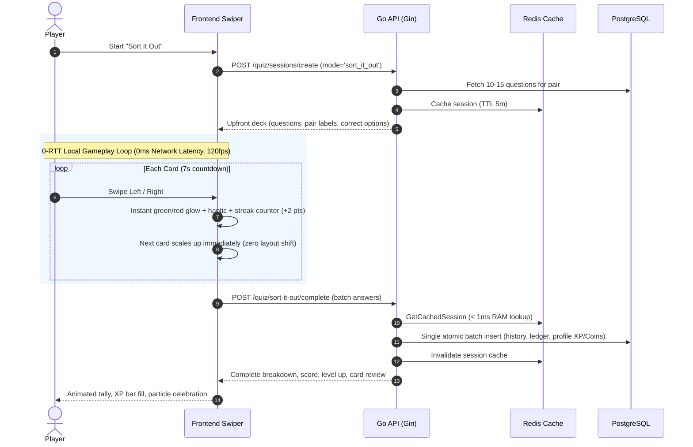

# Implementation Plan: "Sort It Out" Swipe Mini-Game Engine

## Goal Description
Implement the complete backend engine for **"Sort It Out"**, a rapid-fire, binary-choice swipe mini-game (e.g. Credit vs. Debit, True vs. False, Asset vs. Liability).

Key requirements:
1. **Binary Consistency**: In any given session, every card belongs to the exact same pair category (e.g. all Credit/Debit or all Asset/Liability).
2. **Zero-Latency Client Swiping**: When a session is created, all questions, binary options, and correct answers are loaded upfront in the response payload. The frontend does not make network calls while swiping cards.
3. **Time Pressure & Auto-Advance**: Configurable 5–10 second per-card countdown (default 7s). If the timer runs out on a card, it counts as missed/timed out with 0 points, breaks the streak, and auto-advances.
4. **Hybrid Feedback**:
   - **In-Game**: Frontend handles instant non-blocking visual/haptic feedback (card color, swipe sound, streak counter).
   - **Post-Game**: Detailed end-of-game summary with full review of all cards, explanations, economy rewards, and score breakdown.
5. **Dedicated Batch Completion API**: At the end of the deck, the frontend submits all answered cards at once via `POST /quiz/sort-it-out/complete` (and mirrored at `POST /api/v1/quiz/sort-it-out/complete`).
6. **Speed & Combo Multipliers**: Authoritative backend grading awards:
   - Base Points: 10 pts per correct answer
   - Speed Bonus: +5 pts if swiped in < 2.0s, +2 pts if < 4.0s
   - Combo Streak Bonus: +2 pts per consecutive correct streak step (capped at +10 pts)
   - Economy Rewards: Session XP, Coins, streak updates, and atomic wallet ledger transactions.
7. **Redis Game Session Caching**: Cache active game sessions in Redis (`quiz:session:cache:<id>`) with write-through/cache-aside so session lookups avoid PostgreSQL queries for maximum speed, with transparent fallback if Redis is unavailable.

---

## User Review Required
> [!IMPORTANT]
> - **Redis Session Caching**: Active sessions will be cached in Redis (`quiz:session:cache:<id>`). Lookups check Redis first, completely bypassing DB roundtrips during session operations. If Redis is unavailable, it gracefully falls back to PostgreSQL.
> - **Schema Migration**: A new column `pair_type` (`varchar(32)`) will be added to the `questions` and `game_sessions` tables. GORM's `AutoMigrate` handles this seamlessly without modifying existing rows.
> - **Upfront Correct Answers**: Per your requirement for zero latency, the session creation endpoint returns `correct_option` and `explanation` upfront for `sort_it_out` sessions so the frontend can evaluate swipes locally without hitting the backend.
> - **Scoring Override for Sort It Out**: While standard MCQ keeps fixed 10-point scoring, `sort_it_out` mode implements the agreed Speed + Combo formula.

---

## Proposed Changes

```mermaid
graph TD
    Client[Frontend Client] -->|1. POST /quiz/sessions/create<br/>(game_mode='sort_it_out', pair_type='credit_debit')| CreateSession[Create Session API]
    CreateSession -->|Save to DB + Cache in Redis<br/>TTL = 5 min| RedisCache[(Redis Cache)]
    CreateSession -->|Return questions + upfront answers| Client
    Client -->|2. Local Fast Swipes<br/>5-10s per card, instant visual feedback| LocalPlay[Local Gameplay & Timer]
    LocalPlay -->|3. POST /quiz/sort-it-out/complete<br/>(batch answers: time_taken_ms, options)| BatchComplete[Dedicated Sort It Out Complete API]
    BatchComplete -->|Check cache first<br/>Fast sub-millisecond retrieval| RedisCache
    BatchComplete -->|Fall back to DB if cache miss| DB[(PostgreSQL)]
    BatchComplete -->|Atomic score, rewards, ledger, profile update,<br/>and invalidate cache| DB
    BatchComplete -->|Detailed breakdown, review, rewards, level| Client
```

---

## Ultra-Low Latency & Best User Experience Architecture



### 1. Latency Breakdown & Engineering Guarantees
| Action | Traditional Architecture | Sort It Out Optimized Architecture | Latency Reduction |
| :--- | :--- | :--- | :--- |
| **Card Swipe & Grading** | 80ms – 250ms (per-card HTTP/WS roundtrip) | **0ms** (Upfront evaluation in frontend memory) | **100% eliminated** |
| **Card Transition / Next Card** | 50ms – 100ms (waiting for server frame) | **< 16ms** (60/120fps hardware-accelerated CSS/JS) | **Zero perceived delay** |
| **Session State Retrieval** | 10ms – 25ms (PostgreSQL indexed query) | **< 1ms** (Redis in-memory cache lookup) | **~95% faster** |
| **History Logging** | 15ms – 30ms (10 individual SQL INSERTs) | **~2ms** (Single multi-row batch INSERT) | **~85% faster** |
| **Network Resilience** | Disconnect mid-game freezes the timer | **100% offline-tolerant during the round**; completion payload retried on reconnect | **Zero dropped games** |

### 2. Frontend UX & Micro-Interactions Blueprint
1. **120fps Gesture Physics**:
   - Touch drag triggers proportional card rotation (±15° max) and translates with the finger.
   - Direction badges (`DEBIT` on top-left, `CREDIT` on top-right) dynamically adjust opacity based on drag distance (0% at center, 100% at swipe threshold).
   - If drag exceeds 35% screen width or velocity exceeds 0.5px/ms, the card smoothly flies off-screen; otherwise springs back into place.
2. **Instant Dopamine Feedback**:
   - Correct swipe: instant subtle green border glow + pleasant ding + combo streak counter bumps up with a fire burst effect (`🔥 3x STREAK (+6 pts)`).
   - Incorrect swipe: subtle crimson flash + gentle 4px screen shake + soft buzz, resetting the combo streak without pausing gameplay.
   - Next card is pre-rendered underneath at 0.95 scale and 0.8 opacity, immediately transitioning to 1.0 scale as the top card departs.
3. **Fluid Time Urgency**:
   - A sleek horizontal or circular SVG progress meter smoothly depletes over 7 seconds.
   - Color transitions dynamically: Cyan/Blue (7s–3s) → Amber Warning (3s–1.5s) → Crimson Pulse (< 1.5s).
   - On timeout: Card auto-slides away with a "TIME'S UP" stamp, streak resets, and the next card immediately slides in.
4. **Post-Game Celebration & Learning Review**:
   - Roll-up score counter animation (0 → Final Score).
   - XP progress bar fills up toward the next level with a celebratory banner if a level-up occurred.
   - Expandable "Review Missed Cards" accordion with clear explanations for any questions the player got wrong, turning every mistake into a learning opportunity.

---

### Component 1: Data Models & Database Migration

#### [MODIFY] [internal/models/game_model.go](file:///Users/omkargeedh/Developer/Gamified%20Quiz%20App/GamifiedQuizApp_digitalHQ/internal/models/game_model.go)
- Add game mode constant:
  ```go
  const GameModeSortItOut = "sort_it_out"
  ```
- In `Question` struct:
  - Add `PairType string` with tag `gorm:"column:pair_type;size:32;index:idx_questions_pair_type" json:"pair_type,omitempty"`.
- In `SessionQuestion` struct:
  - Add `PairType string` with tag `json:"pair_type,omitempty"`.
- In `GameSession` struct:
  - Add `PairType string` with tag `gorm:"column:pair_type;size:32" json:"pair_type,omitempty"`.
  - Add helper method `IsSortItOut() bool`.

---

### Component 2: Request & Response DTOs

#### [MODIFY] [internal/dto/game_dto.go](file:///Users/omkargeedh/Developer/Gamified%20Quiz%20App/GamifiedQuizApp_digitalHQ/internal/dto/game_dto.go)
- In `CreateSessionRequestDTO`:
  - Add `PairType string `json:"pair_type,omitempty"``
  - Add `TimeLimitPerQuestionSec int `json:"time_limit_per_question_sec,omitempty"``
  - Update `Validate()` to accept `models.GameModeSortItOut` and enforce `TimeLimitPerQuestionSec` range (5–10 seconds, default 7s for `sort_it_out`).
- In `QuestionDTO`:
  - Add `PairType string `json:"pair_type,omitempty"``
  - Add `Explanation *string `json:"explanation,omitempty"`` (included for sort-it-out upfront load).
- In `SessionCreatedResponseDTO`:
  - Add `PairType string `json:"pair_type,omitempty"``
- New DTOs for batch submission:
  ```go
  type SortItOutAnswerSubmissionDTO struct {
      Question    string `json:"question" binding:"required"`
      Option      string `json:"option" binding:"required"` // "a", "b", or "skip"/"timeout"
      TimeTakenMs int    `json:"time_taken_ms"`
      IsTimeout   bool   `json:"is_timeout,omitempty"`
  }

  type CompleteSortItOutRequestDTO struct {
      Session string                         `json:"session" binding:"required"`
      Answers []SortItOutAnswerSubmissionDTO `json:"answers" binding:"required"`
  }

  type SortItOutCardReviewDTO struct {
      Question       string  `json:"question"`
      Prompt         string  `json:"prompt"`
      SelectedOption string  `json:"selected_option"`
      CorrectOption  string  `json:"correct_option"`
      IsCorrect      bool    `json:"is_correct"`
      IsTimeout      bool    `json:"is_timeout"`
      TimeTakenMs    int     `json:"time_taken_ms"`
      BasePoints     int     `json:"base_points"`
      SpeedBonus     int     `json:"speed_bonus"`
      ComboBonus     int     `json:"combo_bonus"`
      PointsEarned   int     `json:"points_earned"`
      Explanation    *string `json:"explanation,omitempty"`
  }

  type CompleteSortItOutResponseDTO struct {
      Session            string                   `json:"session"`
      PairType           string                   `json:"pair_type"`
      TotalQuestions     int                      `json:"total_questions"`
      CorrectCount       int                      `json:"correct_count"`
      TimeoutCount       int                      `json:"timeout_count"`
      BestStreak         int                      `json:"best_streak"`
      AccuracyPercentage float64                  `json:"accuracy_percentage"`
      FinalScore         int                      `json:"final_score"`
      CoinsAwarded       int                      `json:"coins_awarded"`
      XPAwarded          int                      `json:"xp_awarded"`
      GemsAwarded        int                      `json:"gems_awarded"`
      ScoreBreakdown     map[string]int           `json:"score_breakdown"`
      CoinBreakdown      map[string]int           `json:"coin_breakdown"`
      XPBreakdown        map[string]int           `json:"xp_breakdown"`
      LevelUpReward      *LevelUpRewardDTO        `json:"level_up_reward,omitempty"`
      Level              LevelInfoDTO             `json:"level"`
      Streak             StreakInfoDTO            `json:"streak"`
      CardsReview        []SortItOutCardReviewDTO `json:"cards_review"`
  }
  ```

---

### Component 3: Data Repository Layer & Redis Session Cache with Strict TTL

#### [NEW] [internal/repo/session_cache.go](file:///Users/omkargeedh/Developer/Gamified%20Quiz%20App/GamifiedQuizApp_digitalHQ/internal/repo/session_cache.go)
- **TTL Strategy & Lifecycle**:
  - **Inactivity TTL**: Fixed at 5 minutes (`services.SessionInactivityTTL = 5 * time.Minute`).
  - **Key Structure**: `quiz:session:cache:<session_id>`
  - **Cache Set**: Whenever a session is written to Redis, it is strictly accompanied by the 5-minute TTL:
    ```go
    config.RedisClient.Set(ctx, cacheKey(session.ID), data, SessionInactivityTTL)
    ```
  - **TTL Refresh**: On every read / cache hit, `EXPIRE quiz:session:cache:<id> 300` is triggered to slide the expiration window while the player is active.
  - **Automatic Expiration**: If the player leaves the app, the session key automatically self-destructs in Redis after 5 minutes, preventing Redis memory leaks.
  - **Explicit Invalidation**: Once `POST /quiz/sort-it-out/complete` or `POST /quiz/sessions/abandon` is called, the cache key is immediately deleted via `DEL quiz:session:cache:<id>`.
  - **Graceful Fallback**: If Redis is down, all operations proceed through PostgreSQL seamlessly without throwing errors.

- **Methods**:
  - `CacheSession(ctx context.Context, session *models.GameSession) error`
  - `GetCachedSession(ctx context.Context, sessionID string) (*models.GameSession, bool)`
  - `RefreshSessionCacheTTL(ctx context.Context, sessionID string) error`
  - `InvalidateCachedSession(ctx context.Context, sessionID string) error`

#### [MODIFY] [internal/repo/game_repo.go](file:///Users/omkargeedh/Developer/Gamified%20Quiz%20App/GamifiedQuizApp_digitalHQ/internal/repo/game_repo.go)
- Update `GetSessionByID(ctx, sessionID)`:
  - Checks Redis cache via `GetCachedSession(ctx, sessionID)`.
  - On cache hit: refreshes TTL and returns session directly (0 DB queries!).
  - On cache miss: queries PostgreSQL and populates Redis with the 5-minute TTL.
- Update `CreateSession`:
  - Persists session to PostgreSQL.
  - Immediately caches in Redis with 5-minute TTL.
- Update `UpdateSession`:
  - Updates PostgreSQL row.
  - Updates Redis cache with fresh 5-minute TTL.
- Update `FinalizeSession`:
  - Commits transaction in PostgreSQL.
  - Invalidates Redis cache key.
- Add repository methods:
  - `GetDistinctPairTypes(ctx, topicID, mode) ([]string, error)`: Fetches available pair types for a topic.
  - `GetSortItOutQuestions(ctx, topicID, pairType, limit) ([]models.Question, error)`: Fetches questions matching the specified topic and pair type.
  - `RecordBatchAnswers(ctx, history []*models.UserQuestionHistory) error`: Efficient batch insertion into `user_question_history`.

---

### Component 4: Business Logic & Scoring Service

#### [MODIFY] [internal/services/game_service.go](file:///Users/omkargeedh/Developer/Gamified%20Quiz%20App/GamifiedQuizApp_digitalHQ/internal/services/game_service.go)
- **Session Creation Support**:
  - In `CreateSession`: handle `GameModeSortItOut`.
  - If `req.PairType` is provided, fetch questions for that pair. If empty, randomly pick an available `pair_type` in the topic.
  - For `sort_it_out`, set `TimeLimitPerQuestionSec` (default 7s, or req value 5–10s).
  - Include `correct_option` and `explanation` in `questionDTOs` for `sort_it_out`.
- **Scoring Engine**:
  - Implement `CalculateSortItOutPoints(isCorrect bool, timeTakenMs int, comboStreak int) (basePts, speedBonus, comboBonus, totalPts int)`:
    - Base: 10 pts if correct
    - Speed bonus: +5 pts if `< 2000ms`, +2 pts if `< 4000ms`
    - Combo bonus: `min(comboStreak * 2, 10)` pts
- **Batch Finalization**:
  - Implement `CompleteSortItOutSession(ctx, clientID int, req *dto.CompleteSortItOutRequestDTO) (*dto.CompleteSortItOutResponseDTO, int, error)`:
    - Validates session ownership, active status, inactivity timeout.
    - Validates that questions in answers match the session questions.
    - Iterates sequentially through answers, updates combo streak, calculates points, prepares review records and `UserQuestionHistory` entries.
    - Computes rewards (XP and Coins, perfect run bonus if 100% correct).
    - Atomically calls `repo.FinalizeSession` and profile level updates.
    - Returns rich `CompleteSortItOutResponseDTO`.

---

### Component 5: Handlers & Dual Route Registration

#### [MODIFY] [internal/handlers/game_handler.go](file:///Users/omkargeedh/Developer/Gamified%20Quiz%20App/GamifiedQuizApp_digitalHQ/internal/handlers/game_handler.go)
- Add `CompleteSortItOutHandler(c *gin.Context)`:
  - Binds JSON to `dto.CompleteSortItOutRequestDTO`.
  - Extracts `clientID` from context.
  - Calls `services.CompleteSortItOutSession`.
  - Returns `response.Success` or `response.Error`.

#### [MODIFY] [internal/routes/game_routes.go](file:///Users/omkargeedh/Developer/Gamified%20Quiz%20App/GamifiedQuizApp_digitalHQ/internal/routes/game_routes.go)
- Inside `registerQuizRoutes(grp *gin.RouterGroup)` (ensuring automatic dual registration for `/quiz` and `/api/v1/quiz`):
  ```go
  grp.POST("/sort-it-out/complete", handlers.CompleteSortItOutHandler)
  ```

---

### Component 6: Seed Questions

#### [MODIFY] [internal/data/seed_questions.json](file:///Users/omkargeedh/Developer/Gamified%20Quiz%20App/GamifiedQuizApp_digitalHQ/internal/data/seed_questions.json)
- Add 25+ rich questions for `sort_it_out` with pairs:
  - `credit_debit` (10 questions on accounting journal entries / accounts)
  - `asset_liability` (10 questions on balance sheet classification)
  - `true_false` (10 questions on core accounting principles)

---

## Verification Plan

### Automated Tests
1. **Unit & Service Tests**:
   - `internal/services/game_service_test.go`:
     - Test `CalculateSortItOutPoints` with various speed thresholds (<2s, <4s, >=4s) and streaks.
     - Test `CreateSession` for `sort_it_out` verifying upfront answers and consistent `pair_type`.
     - Test `CompleteSortItOutSession` verifying correct scoring, history audit, and profile level-up progression.
2. **Handler & Route Mirror Tests**:
   - `internal/handlers/game_handler_test.go`:
     - Test `CompleteSortItOutHandler` valid submission, empty answers validation, and wrong user forbidden check.
   - `internal/routes/routes_test.go`:
     - Assert `/quiz/sort-it-out/complete` and `/api/v1/quiz/sort-it-out/complete` both resolve properly without 404.
3. **Full Test Suite Run**:
   - Run `go test -v ./...` to guarantee 100% pass rate.

### Manual Verification
1. Call `POST /quiz/sessions/create` with `{"topic": "accounting", "game_mode": "sort_it_out", "pair_type": "credit_debit"}`.
   - Verify all returned questions have `pair_type: "credit_debit"`, `option_a: "Debit"`, `option_b: "Credit"`, `correct_option` populated, and `time_limit_per_question_sec: 7`.
2. Call `POST /quiz/sort-it-out/complete` with simulated fast swipes (<2s), streak, and 1 timeout.
   - Verify speed bonuses and combo bonuses are applied, wallet ledger records transactions, and cards review contains full audit details.
